# Fetal Head Biometry from 2D Ultrasound: Landmark Detection vs Segmentation

I measure the fetal head in axial ultrasound images in two different ways and compare them honestly:

- **Part A, landmark detection.** An ImageNet-pretrained HRNet-W32 predicts the four end-points of the occipito-frontal (OFD) and biparietal (BPD) diameters as Gaussian heatmaps. A direct coordinate-regression model with the same backbone is the controlled baseline.
- **Part B, segmentation.** A U-Net segments the skull, an ellipse is fitted to the predicted mask, and the end-points and head circumference are read from the ellipse axes. Self-/cross-attention and a Hausdorff-type boundary loss were tested as extensions.

This README is the full write-up. The code that produced every number is in [`part_a_landmark_detection/`](part_a_landmark_detection/) and [`part_b_segmentation/`](part_b_segmentation/), and the original PDF reports go in [`reports/`](reports/).

**Stack:** Python, PyTorch, timm, OpenCV, albumentations, pandas, SciPy, scikit-learn, matplotlib

| | Part A: heatmap landmarks (HRNet-W32) | Part B: segmentation + ellipse (U-Net) |
|---|---|---|
| Test set | 47 images, 45 patients | 56 images, 50 patients |
| Headline result | Median landmark error **1.65 mm**; **70.7 %** of landmarks within 2 mm | Mean Dice **0.969** (median 0.978) |
| Length / end-point error | Median length error **1.0 % (OFD), 1.5 % (BPD)** | Median end-point error **12.1 px (OFD), 9.5 px (BPD)** |
| Head circumference | ICC **0.90** | Median absolute error 9.9 px |
| Main experiment | Heatmap beats coordinate regression on landmark placement (median 1.65 vs 2.48 mm), but the coordinate model agrees better on OFD, BPD and HC | Attention and HD loss gave no significant gain after correction, so the simpler baseline U-Net was kept |

<p align="center">
  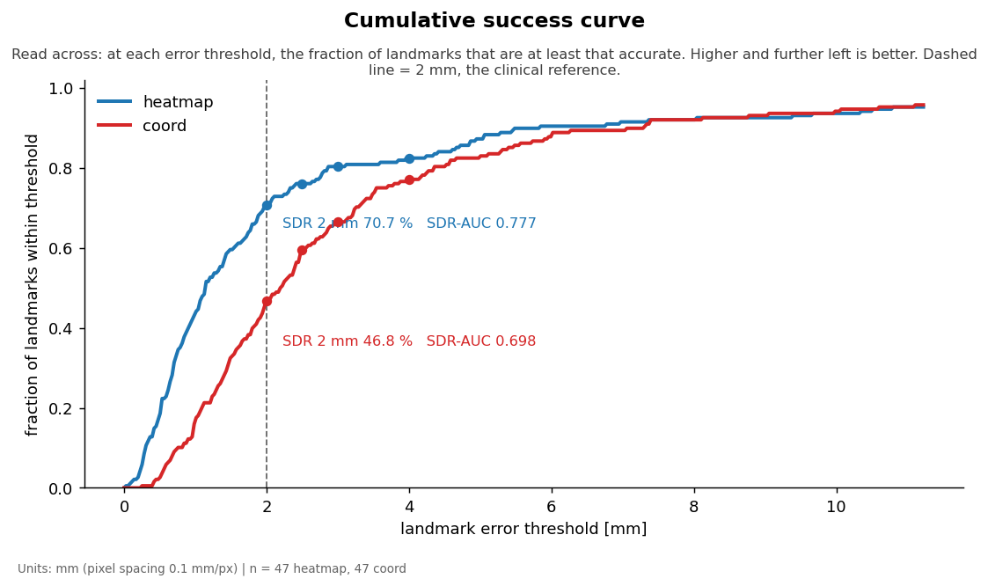
  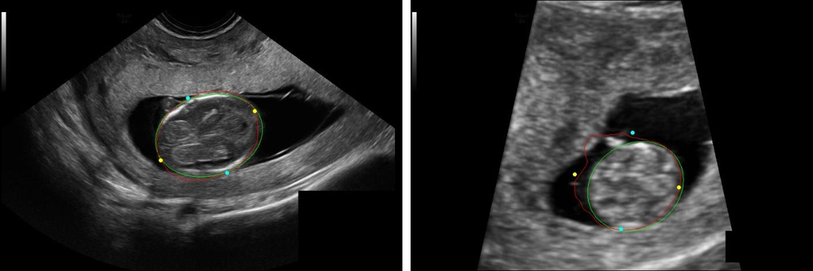
</p>
<p align="center"><em>Left: share of landmarks within a given error, heatmap vs coordinate regression (Part A). Right: predicted mask, fitted ellipse and biometry points on the best and worst test images (Part B; green = ground truth, red = prediction, yellow = OFD points, blue = BPD points).</em></p>

> **Read the numbers with care.** The two parts use **different splits, different test sets and different units** (Part A in mm assuming 0.1 mm/px, Part B in pixels), so their errors are not directly comparable. Part A also removed 24.4 % of the annotations before training. Both test sets are small (47 and 56 images). Limitations are discussed in each part and in [Honest assessment](#honest-assessment).

## Contents

1. [Why this problem](#why-this-problem)
2. [Dataset](#dataset)
3. [Part A: landmark detection](#part-a-landmark-detection)
4. [Part B: segmentation and ellipse fitting](#part-b-segmentation-and-ellipse-fitting)
5. [Comparing the two approaches](#comparing-the-two-approaches)
6. [Repository guide](#repository-guide)
7. [References](#references)

---

## Why this problem

Fetal head biometry is one of the main ways to estimate gestational age and track fetal growth. The **biparietal diameter (BPD)**, **occipito-frontal diameter (OFD)** and **head circumference (HC)** are measured on an axial ultrasound image, and the measurements depend on where the calipers are placed on the skull edges. Placement is done by hand, so the result varies between sonographers, and that variation carries into every gestational age estimate that depends on it. The International Society of Ultrasound in Obstetrics and Gynecology (ISUOG) describes these measurements in its routine mid-trimester practice guideline and recommends standard placement conventions to make them comparable.

Automation addresses the same problem in two ways, which this project compares:

- **Detect the end-points directly** (Part A): the four biometry end-points are placed the same way on every image, and images where the placement looks implausible can be flagged for review.
- **Segment the skull and derive the end-points geometrically** (Part B): each error becomes traceable to either the mask or the ellipse fit, and the segmentation quality can be evaluated on its own.

## Dataset

Both parts use the same set of axial fetal head ultrasound images, named `NNN_HC.png` (and `NNN_2HC.png` for a second image of the same patient). The leading digits are the patient identifier, which both parts use to split the data by patient. The data are not included in this repository; see each part's `data/README.md`.

| Item | Part A | Part B |
|---|---|---|
| Images | 622; 608 are 540 × 800 px (height × width), the other 14 have heights of 539 to 563 px and widths of 738 to 800 px | 622 image/ground-truth pairs (620 used, 2 excluded) |
| Ground truth | Four landmarks per image (OFD end 1 and 2, BPD end 1 and 2) in pixel coordinates, from `role_challenge_dataset_ground_truth.csv` | A 1-pixel ellipse outline per image, filled into a mask |
| Patients | 501 identifiers | 399 / 50 / 50 patients in train / val / test |
| Pixel spacing | 0.1 mm per pixel (the millimetre values are pixel values × 0.1; the run configuration does not store the spacing) | Not used; all distances are in pixels |

---

# Part A: landmark detection

## A1. Abstract

I detect four biometry end-points in axial fetal head ultrasound. After a ground-truth check removed 152 of 622 annotations (470 kept), I trained an ImageNet-pretrained HRNet-W32 to predict one Gaussian heatmap per landmark, decoded by argmax with sub-pixel refinement. A patient-grouped split gave 376 training, 47 validation and 47 test images. On the test set the median per-image landmark error was **1.65 mm** (mean 2.94 mm), with **70.7 %** of landmarks within 2 mm. The mean OFD and BPD length errors were 3.9 % and 4.9 % of the true length (median 1.0 % and 1.5 %), and the head circumference ICC was 0.90. Compared with direct coordinate regression on identical data, the heatmap model had lower landmark error, while the coordinate model gave better occipito-frontal length agreement.

## A2. Approach

The landmarks are predicted as **heatmaps rather than coordinates**. Heatmap regression keeps the spatial layout of the image in the output, so every pixel supervises the landmark, and the network does not have to store position in fully connected weights. The HRNet backbone keeps a high-resolution representation through the whole network, which suits a task where a few pixels matter.

A direct coordinate-regression model with the same backbone, data and schedule was trained as a baseline. The hypothesis is that the heatmap model is more accurate, and the comparison in [A7](#a7-heatmap-vs-coordinate-regression) tests it. The backbone was chosen from the literature; other backbones were not compared.

## A3. Data preprocessing and analysis

### A3.1 Ground-truth check

Each annotation was checked for plausibility before training. The two diameters are chords of the same roughly elliptical outline, so they should be close to perpendicular, their midpoints should nearly coincide, and neither should be implausibly short. A landmark outside the image is simply impossible. These rules encode anatomy rather than a statistical preference, which is why I was willing to remove rows automatically. A row was removed when:

- OFD and BPD are more than 30 degrees from perpendicular;
- the two line midpoints are more than 150 px apart;
- an OFD or BPD is shorter than 100 px;
- a landmark is outside the image.

| Check | Rows flagged | Action |
|---|---|---|
| Not perpendicular (more than 30 deg) | 116 | Removed |
| Midpoint gap (more than 150 px) | 109 | Removed |
| Short OFD (under 100 px) | 18 | Removed |
| Short BPD (under 100 px) | 8 | Removed |
| Debugging exclusion list | 0 | Not applied |
| Duplicate, missing or unreadable | 0 | None |
| **Total removed** (a row can fail more than one check) | **152 (24.4 %)** | Removed |
| **Total kept for training and testing** | **470** | Kept |

I also recognise the limits of this rule. A large share of rows was removed, and most removals came from the perpendicularity and midpoint checks. That may mean that many annotations are wrong, or it may mean that the annotation convention differs from the one my rule assumes, for example in how the biparietal diameter is drawn. Telling these apart needs the annotator, which is listed under future work.

<p align="center">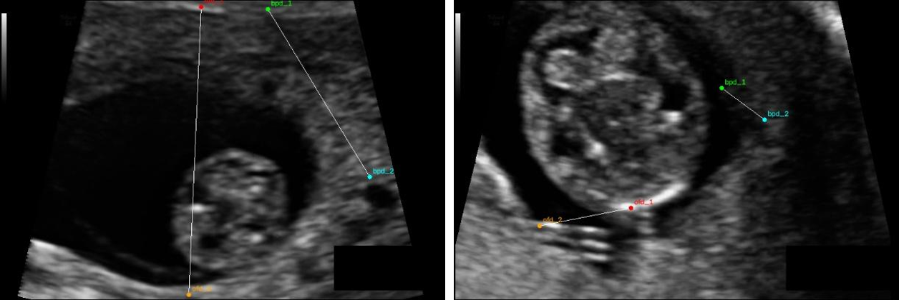</p>
<p align="center"><em>Examples of removed annotations, with the landmarks drawn on the image.</em></p>

<p align="center">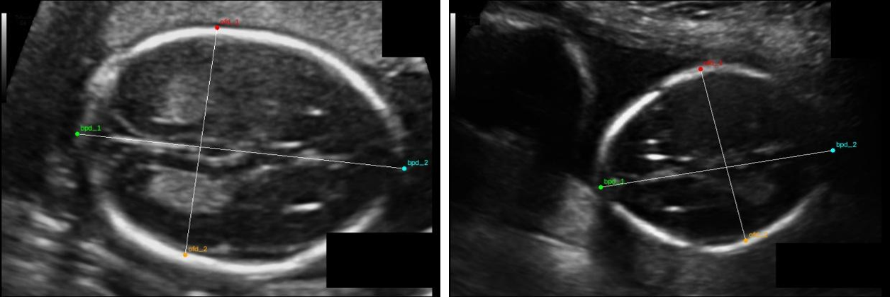</p>
<p align="center"><em>Examples of kept annotations after preparation, confirming that the landmarks sit on the head.</em></p>

### A3.2 Patient-grouped split

The split is grouped by patient, so no patient appears in two sets. Images from the same patient are strongly alike, because they share anatomy, equipment and often the same examination. If images of one patient appear in both training and testing, the test measures recall of that patient rather than generalisation to new patients. Patients differ in how many images they contribute and in head size, so a simple random assignment would leave the sets unbalanced. I used a search that keeps every patient together while balancing the set sizes and spreading image size and head size evenly across the three sets (`src/splitting.py`). This is a design decision made to protect the evaluation, not a finding about the dataset. It rests on one assumption that should be stated explicitly: that the file name identifies the patient.

| Set | Images | Patients | Share of images |
|---|---|---|---|
| Train | 376 | 301 | 80.0 % |
| Validation | 47 | 45 | 10.0 % |
| Test | 47 | 45 | 10.0 % |

The three sets contain 391 patients in total, out of 501. The other 110 patients have no image left, because all of their annotations were removed in the ground-truth check.

### A3.3 Preprocessing

| Step | Setting | Reason |
|---|---|---|
| Resize | Each image is stretched to 384 × 384 px. Landmarks are scaled with the same factors, and predictions are mapped back to original pixels. | Keeps every pixel of the anatomy. Stretching does change the apparent proportions of the head; letterboxing, which pads to a square while preserving proportions, is the more principled choice and is planned as a test. |
| Contrast | CLAHE (clip limit 2.0, 8 × 8 tiles) | Ultrasound images often have low and uneven contrast. CLAHE spreads intensities within small regions, so faint skull boundaries become easier to see without globally changing the image. |
| Normalisation | Mean 0.449, standard deviation 0.226; the single grey channel is repeated three times | Matches the input range the pretrained backbone expects. |
| Targets | Gaussian heatmap per landmark, sigma 2.0 heatmap cells, at stride 4 (96 × 96 cells) | Gives a spatial target for each landmark. |

### A3.4 Augmentation (training set only)

| Transform | Probability | Setting | Reason |
|---|---|---|---|
| Horizontal flip | 0.5 | Mirrors image and landmarks | The endpoints keep their anatomical role under a left-right flip, so no labels are swapped. Vertical flips were not used, because the images share a consistent probe orientation. |
| Affine | 0.7 | Rotation up to 15°, scale up to 10 %, shift up to 5 %. Landmarks move with the image. | The position and orientation of the head vary between acquisitions, so these changes are realistic. Moving the landmarks with the image keeps the geometry correct. |
| Brightness and contrast | 0.5 | Image only | Imitates differences in gain between machines and operators. |
| Gamma | 0.3 | Image only | Imitates differences in dynamic range. |
| Blur or Gaussian noise | 0.3 | Image only | Imitates differences in focus and speckle. |

## A4. Model architecture

The proposed model is **HRNet-W32 with ImageNet pretraining** (timm). The backbone returns features at several resolutions. These are resized to the 96 × 96 heatmap grid, concatenated, reduced to 256 channels with a 1 × 1 convolution, refined by a 3 × 3 convolution, and mapped to four heatmaps by a final 1 × 1 convolution. The landmark is the peak of each heatmap, refined to a quarter of a cell toward the higher neighbour. Parameters: 31.98 M.

**Why heatmaps.** A convolutional network is well suited to answering where a pattern occurs in an image. A heatmap has the same spatial layout as the image, so each location contributes evidence about whether it is a landmark, and the position is read from the shape of that evidence. Direct coordinate regression asks the network to compress the image into a short vector and then to recover location from learned weights, which discards much of the spatial structure.

**Why HRNet.** HRNet keeps a high-resolution representation through the whole network rather than repeatedly shrinking the image and then rebuilding it, as a classic encoder-decoder such as U-Net does. For landmarks that depend on a few pixels, keeping resolution seems the more appropriate design.

**Why ImageNet pretraining.** The dataset is small. Early layers learn generic edges and textures that transfer across image domains, so the network does not need to learn basic vision from limited medical data. The head on top of the backbone was kept deliberately simple, so that behaviour can be attributed to a small number of design choices.

**Baseline: direct coordinate regression.** The same backbone with a coordinate head: features at stride 32 are flattened and passed through a 512-unit fully connected layer to eight coordinates. A variant with global average pooling in place of the flattening (`--head gap`) was also planned as a harder baseline, which removes all position information. Everything else (backbone, data, split, augmentation, schedule and metrics) is kept identical, so any difference in results can be attributed to that choice.

## A5. Experimental setting

| Setting | Heatmap model (proposed) | Coordinate baseline |
|---|---|---|
| Optimiser | AdamW, learning rate 1e-3, weight decay 1e-4 | same |
| Schedule | 5-epoch linear warmup, then cosine decay | same |
| Batch size, input | 4, 384 × 384 | same |
| Epochs | Maximum 150; early stopping with patience 30; stopped at epoch 70 (best epoch 40) | same rule |
| Loss | Mean squared error on heatmaps | Smooth L1 (beta 0.02) on normalised coordinates |
| Gradient clipping | Norm 5.0 | same |
| Model selection | Lowest validation landmark error | same |
| Mixed precision | Yes (CUDA) | same |
| Augmentation and CLAHE | On, training set only | same |

The coordinate baseline inherits the heatmap model's settings with the `--inherit` option; only the head and the loss differ. The test set was used once, after model selection on the validation set.

The training settings were chosen to be conventional and identical for both models, so that any difference is not caused by tuning one model more than the other. AdamW decouples weight decay from the adaptive step, which makes the regularisation behave as intended with a pretrained network. A short linear warmup lets the randomly initialised head settle before the pretrained backbone receives full-size updates, and cosine decay lowers the learning rate smoothly towards the end. Gradient clipping guards against rare large updates. Mixed precision was used to fit the high-resolution network on a modest GPU. Early stopping ended training before the schedule finished. That is a reasonable use of the validation set, but it means the model may not have fully converged, and I report it as such.

## A6. Results

### A6.1 Headline result (proposed model, 47 test images)

Run `hrnet_w32_base_run1`, checkpoint from epoch 40. Millimetre values use 0.1 mm/px. The median is the median of per-image mean error.

| Measure | Value |
|---|---|
| Mean landmark error | 2.94 mm (95 % CI 1.95 to 4.17) |
| Median landmark error | 1.65 mm (95 % CI 1.30 to 2.29) |
| Interquartile range | 1.05 to 3.25 mm |
| 90th percentile; maximum | 4.85 mm; 21.01 mm |
| Landmarks within 2 / 2.5 / 3 / 4 mm (success detection rate, SDR) | 70.7 / 76.1 / 80.3 / 82.4 % |
| SDR-AUC, 0 to 10 mm (1 = perfect) | 0.777 |
| Mean error per endpoint: OFD 1, OFD 2, BPD 1, BPD 2 | 2.80, 3.76, 2.36, 2.84 mm |
| OFD length, mean absolute error; median absolute error (% of true) | 1.53 mm; 1.03 % |
| BPD length, mean absolute error; median absolute error (% of true) | 1.97 mm; 1.45 % |
| Length within 5 % of true (OFD / BPD) | 91.5 / 89.4 % |
| Length bias (OFD / BPD) | -0.73 / -0.87 mm |
| 95 % limits of agreement (OFD / BPD) | -13.3 to +11.9 / -12.2 to +10.5 mm |
| ICC(2,1), absolute agreement (OFD / BPD / HC) | 0.59 / 0.82 / 0.90 |
| Head circumference, mean absolute error (median % of true) | 4.18 mm (1.15 %) |
| Order-invariant NME (OFD / BPD) | 0.098 / 0.071 |
| Endpoints fit better swapped (OFD / BPD) | 0 % / 0 % |
| Images with error above 3 × median | 8.5 % (4 of 47) |
| Share of total error in the worst 10 % of images | 43.4 % |

**SDR** is the percentage of predicted landmarks that fall within a defined distance of the ground-truth coordinate marked by the human expert. Head circumference is computed from the two diameters as HC = 1.62 × (BPD + OFD), as in the ISUOG guideline.

### A6.2 Analysis

- **Accuracy.** The median landmark error is 1.65 mm and 70.7 % of landmarks are within 2 mm. The mean (2.94 mm) is almost twice the median, and the maximum is 21 mm. Four of 47 images (8.5 %) exceed three times the median, and together they carry 43 % of the total error.
- **Length.** The median length error is 1.0 % (OFD) and 1.5 % (BPD). The means are 3.9 % and 4.9 %, so a few images with large length errors pull the mean up. Most images measure within 5 % of the true length (91.5 % OFD, 89.4 % BPD).
- **Endpoint order.** No image fits better with swapped endpoints. The order-invariant NME (0.098 OFD, 0.071 BPD) is close to the usual error, so the error is a localisation error and not a labelling-order problem.
- **Training.** The best validation error was 23.98 px (2.40 mm) at epoch 40. Training stopped at epoch 70 after 30 epochs without improvement. The schedule had not finished, so the model may not have fully converged.
- **Bias and agreement.** The length bias is small (-0.73 mm OFD, -0.87 mm BPD), but the limits of agreement are wide, about 12 mm either side. Some images therefore disagree with the reference by more than a clinician would accept.
- **Limitations.** The test set is one split of 47 images, so the intervals are wide. 152 of 622 annotations were removed, so the results apply to the kept subset. The reference is an expert annotation, so agreement is measured against the annotation, not the true anatomy.

### A6.3 Figures

<p align="center">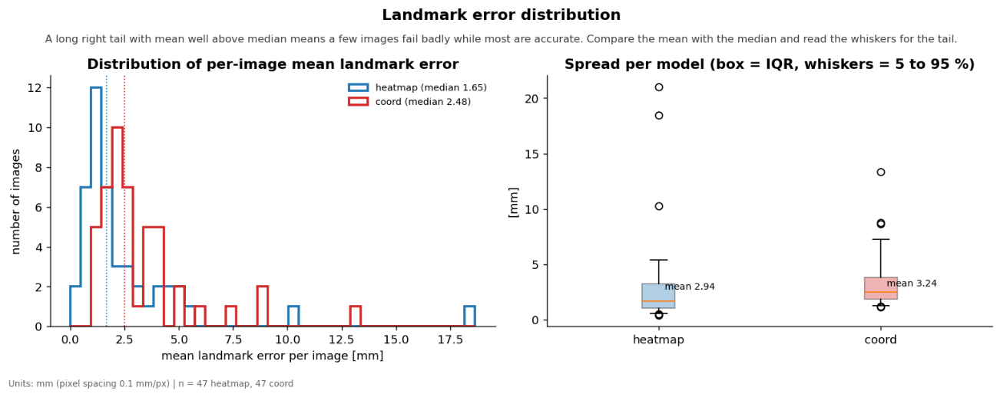</p>
<p align="center"><em>Distribution of per-image mean landmark error for both models. A long right tail with a mean well above the median means a few images fail badly while most are accurate.</em></p>

<p align="center"></p>
<p align="center"><em>Cumulative success curve: the fraction of landmarks within each error threshold (dashed line = 2 mm, the clinical reference). Heatmap: SDR at 2 mm 70.7 %, SDR-AUC 0.777. Coordinate: 46.8 %, 0.698.</em></p>

<p align="center">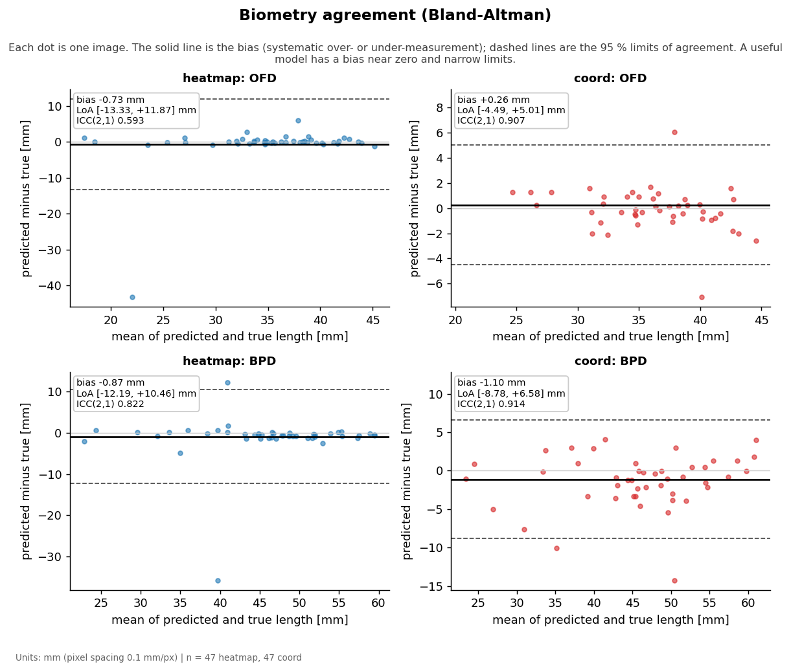</p>
<p align="center"><em>Bland-Altman agreement for OFD and BPD (each dot is one image; solid line = bias, dashed lines = 95 % limits of agreement). The heatmap model's wide limits come from a few isolated large errors; the coordinate model's limits are narrower.</em></p>

## A7. Heatmap vs coordinate regression

**Hypothesis H1-2:** heatmaps beat coordinate regression. **Change:** coordinate head with flattened features, everything else identical. **Status:** run.

Both models were evaluated on the same 47 test images. The Wilcoxon signed-rank test is the primary test because the errors are skewed; Holm correction is applied across the three measures; the 95 % interval is a bootstrap interval for the mean difference. Negative differences favour the heatmap model.

| Measure | Heatmap (proposed) | Coordinate baseline | Difference (95 % CI) | p (Holm) |
|---|---|---|---|---|
| Mean landmark error (mm) | 2.94 | 3.24 | -0.30 (-0.85 to +0.38) | 0.002 |
| Median landmark error (mm) | 1.65 | 2.48 | -0.83 (point estimate) | - |
| OFD mean absolute length error (mm) | 1.53 | 1.45 | +0.09 (-1.08 to +1.91) | 0.001 |
| BPD mean absolute length error (mm) | 1.97 | 2.77 | -0.80 (-1.75 to +0.48) | 0.001 |
| SDR within 2 mm | 70.7 % | 46.8 % | - | - |
| OFD ICC(2,1) | 0.59 | 0.91 | - | - |
| BPD ICC(2,1) | 0.82 | 0.91 | - | - |
| Head circumference ICC(2,1) | 0.90 | 0.97 | - | - |
| OFD 95 % limits of agreement (mm) | -13.3 to +11.9 | -4.5 to +5.0 | - | - |
| BPD 95 % limits of agreement (mm) | -12.2 to +10.5 | -8.8 to +6.6 | - | - |
| Share of error in worst 10 % of images | 43.4 % | 28.8 % | - | - |

**Interpretation.** The heatmap model has lower landmark error across the distribution. Its median is 0.83 mm lower, and about 24 percentage points more of its landmarks are within 2 mm. The mean difference is not decisive, because its 95 % interval includes zero, while the distribution-based test is (Holm p = 0.002). The two models give similar mean OFD length errors. The coordinate model has better OFD agreement (ICC 0.91 against 0.59, and limits of agreement of about 5 mm against 12 mm). It also has better BPD and head circumference ICC. The heatmap model's errors are more concentrated in a few images. So the heatmap model is better for landmark placement, but the two models are comparable on length, with the coordinate model better on OFD agreement.

## A8. Key findings

- Heatmap regression places the landmarks more accurately than coordinate regression on this data: median 1.65 mm against 2.48 mm, and 70.7 % against 46.8 % of landmarks within 2 mm.
- Length measurements are clinically useful for most images: 91.5 % (OFD) and 89.4 % (BPD) are within 5 % of the true length, and the head circumference ICC is 0.90. A minority of images fail, and they dominate the mean error.
- The coordinate model is comparable on mean length error and better on OFD agreement. The heatmap advantage is in landmark placement, not in every clinical measure.
- Endpoint order is not a source of error here. The errors are localisation errors.
- The high removal rate (152 of 622 annotations) is the main open question for the data. The results apply to the 470 kept annotations.

**Final model selected: heatmap regression on an HRNet backbone.** It places landmarks more accurately (lower median and mean landmark error, more landmarks within 2 mm, lower BPD length error). The baseline agrees better with the reference on the clinical measurements (higher OFD, BPD and head circumference ICC, and much narrower OFD limits of agreement).

## A9. Future work

- Check the 152 removed annotations with the annotator, particularly the midpoint-gap and perpendicularity rules, to separate wrong labels from a different annotation convention.
- Letterbox resizing and an input-resolution study, to remove the shape distortion from stretching.
- Patient-grouped k-fold cross-validation and an ensemble of folds, for a more stable estimate of the mean error.

---

# Part B: segmentation and ellipse fitting

## B1. Abstract

Fetal head biometry requires accurate measurement of the OFD and BPD diameters. A U-Net segments the fetal skull in 2D ultrasound, and an ellipse is fitted to the predicted mask to obtain the diameter end-points. Models were trained on 506 images from 399 patients and tested on 56 held-out images from 50 patients, using a patient-wise split to prevent leakage. The baseline U-Net reached a **mean Dice of 0.97**, with **median OFD and BPD end-point errors of 12.1 and 9.5 px**. Adding self- and cross-attention, or a Hausdorff-distance boundary loss, gave no significant improvement, so the baseline was selected. Biometry error, rather than overlap, was the main limitation, showing that overlap metrics alone understate measurement error.

## B2. Approach

Part A treats biometry as direct landmark regression. Part B instead segments the cranium and computes the points geometrically, so segmentation quality can be evaluated on its own. A U-Net was chosen as the standard architecture for small biomedical segmentation datasets, because its skip connections keep the boundary detail needed for a reliable ellipse fit. Self- and cross-attention were added because the skull is a long ring-shaped structure, where global context may help close gaps and correct shape errors. An HD loss was added to penalise boundary distance directly, since end-point error depends on the outermost contour. The working hypotheses were that attention and HD loss would improve overlap and boundary accuracy.

## B3. Data preprocessing and analysis

### B3.1 Dataset and split

| Item | Value |
|---|---|
| Images | 622 image-GT pairs (620 used, 2 excluded); 800 × 540 px (first image checked) |
| Pixel size | Not used: all distances in px |
| Split | Patient-wise 80 / 10 / 10; no patient in two splits |
| Counts (train / val / test) | 506 / 58 / 56 images |
| Patients per split | 399 / 50 / 50 |

Several images in the dataset share a patient number, so a random split of images would place scans of the same patient in both the training and test sets. The model could then recognise a patient rather than learn the skull, and the test score would look better than the model deserves. I therefore split by patient, using the leading digits of each filename. This makes the test set a fair proxy for new patients. The cost is that the test set contains a limited number of patients, so the results carry real uncertainty; I report the spread across images rather than treating a single average as exact. A fixed seed (42) keeps the test set identical across all models, so the comparisons are fair.

### B3.2 Ground-truth check

The ground truth is a one-pixel ellipse outline rather than a filled region, and a segmentation network learns regions, so the first step was to convert each outline into a filled mask. **This step is the one most likely to fail silently:** a gap in the outline lets the fill leak and produce a mask that covers most of the image, and no error message appears. I therefore tried to close gaps of increasing size and accepted a repair only when the resulting region was plausible. Outlines that could not be repaired were excluded rather than guessed, because a wrong mask would teach the network a wrong boundary. I inspected overlays of the masks before training.

| GT status | Count | Handling |
|---|---|---|
| Closed outline (filled) | 620 | Used |
| Already filled mask | 0 | Used |
| Small gap repaired (about 11 px or less) | 0 | Not needed |
| Open outline / empty | 2 | Excluded (listed in `prepare_report.json`) |

<p align="center">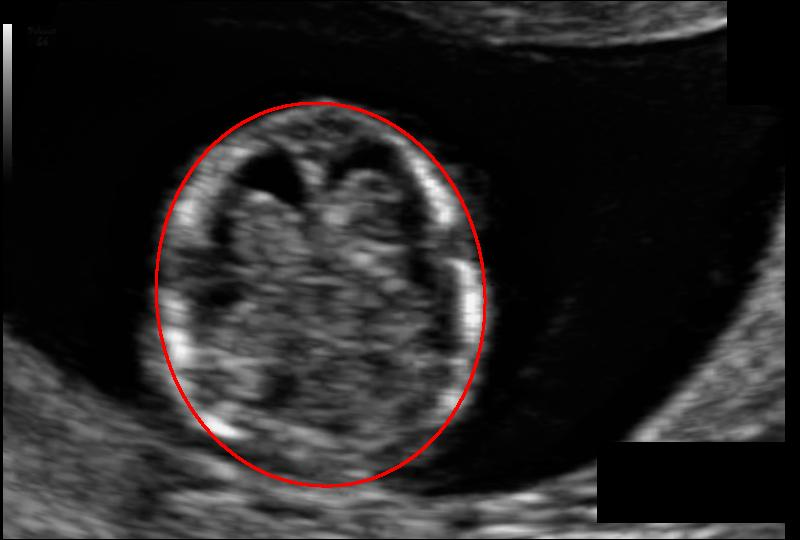</p>
<p align="center"><em>Ground-truth ellipse overlaid on an example image, checked before training.</em></p>

### B3.3 Preprocessing

| Step | Setting |
|---|---|
| Resize | Letterbox to 256 × 256: keep aspect ratio, zero-pad to square (avoids squashing the ellipse) |
| Intensity normalisation | Z-score per image, statistics from the image area only |
| Contrast enhancement | CLAHE off in all three models |
| Inverse mapping | Predictions mapped back to original resolution before any metric or ellipse fit |

Images were resized with the aspect ratio kept and zero-padded to a square, rather than stretched. Stretching would distort the ellipse, and the biometry points are read along its axes, so a distorted head gives wrong diameters even when the mask itself is good. Predictions are mapped back to the original resolution before any measurement, so the reported errors refer to the real image.

Intensity was normalised per image using z-scores computed over the image area only. Ultrasound brightness depends on gain, depth and the device, so per-image normalisation removes a global brightness offset without relying on a dataset-wide statistic that may not transfer between machines. Min-max scaling was rejected because a single bright reflection would compress the rest of the image into a narrow range.

### B3.4 Augmentation (training split only)

| Transform | Probability | Setting |
|---|---|---|
| Horizontal flip | 0.5 | Mirror image and mask |
| Affine | 0.8 | Rotation ±15°, scale 0.85 to 1.15, shift ±8 % |
| Intensity | 0.7 | Gain 0.8 to 1.25, offset ±0.3 (z-score units) |
| Gaussian blur | 0.2 | sigma 0.3 to 1.2 |
| Gaussian noise | 0.3 | sigma 0.02 to 0.10 |

I wanted augmentation to add realistic variation without changing the anatomy. Horizontal flips are included because the head is roughly symmetric about its midline, so a mirrored head is a plausible head. Vertical flips are excluded, because the probe always sits at the top of the image and a flipped image would not match how an ultrasound is acquired. The intensity, blur and noise augmentations target scanner variation rather than anatomy. Small rotations, scale changes and shifts stand in for differences in head position and in how the sonographer holds the probe. Every geometric transform is applied to the image and its mask together, so the label stays aligned. Augmentation is applied only to the training split, because altering test images would change the question being asked. Strong distortion would also change the ellipse the biometry depends on and teach the model a wrong target, so the strengths stay moderate.

## B4. Model architecture

### B4.1 Baseline U-Net

A standard 2D U-Net with four encoder levels (32, 64, 128, 256 channels) and a 512-channel bottleneck. Each block uses two 3 × 3 convolutions with batch normalisation and ReLU. Down-sampling is max-pooling, up-sampling is transposed convolution, and skip connections join encoder and decoder. The output is a 1 × 1 convolution with sigmoid and a threshold of 0.5. It has 7.76 M parameters.

I chose the U-Net as the baseline because it is the standard architecture for segmenting biomedical images from small datasets (Ronneberger et al., 2015). Its encoder captures context at coarse scales, while skip connections carry fine spatial detail from the encoder to the decoder. The fine detail matters for this task more than in many segmentation problems, because the measured end-points sit on the outer boundary, and a few pixels of boundary error change the axis length. I kept the depth at four levels and the first layer at 32 channels: a wider or deeper network has more parameters than a few hundred training images can reliably constrain, and a simpler model is easier to analyse. The baseline also gives a fixed reference point against which every later modification is judged.

### B4.2 Attention U-Net and HD-loss variant

| Component | Baseline U-Net | Attention U-Net | Attention + HD loss |
|---|---|---|---|
| Encoder / decoder levels | 4 | 4 (same convolutional path) | 4 (same as attention) |
| Base channels | 32 | 32 | 32 |
| Self-attention | None | After encoder levels 3 and 4 (bottleneck) | Same as attention |
| Cross-attention | None | On skip levels 2 and 3 (decoder = query, encoder = key/value) | Same as attention |
| Heads / key-value cap | - | 4 heads / at most 1024 tokens per layer | Same as attention |
| Parameters | 7.76 M | 10.79 M (+39 %) | 10.79 M |
| Loss | 0.5 BCE + 0.5 Dice | 0.5 BCE + 0.5 Dice | BCE + Dice + hd_weight × HD term (weight 0.5) |

Self-attention lets the deep layers relate any part of the feature map to any other, which may help the network complete a faint section of the skull from the parts it can see. Cross-attention on the skip connections lets the decoder ask the encoder which features it needs at each scale, a goal similar to the attention gates that Zeng et al. (2021) use for head segmentation. Attention is expensive, because its cost grows with the square of the number of positions. I therefore applied self-attention only to the two deepest levels, where the feature maps are small, applied cross-attention only to the two deepest skips, and capped the number of keys and values so each layer stays within a fixed budget. The price is about 39 % more parameters, which I treated as an experiment to be justified by results rather than as a settled design. The attention blocks are gated with zero-initialised gates, so the attention model starts out reproducing the baseline output exactly; `tools/check_model.py` verifies this.

**The Hausdorff-type loss.** Following Karimi and Salcudean (2019), the HD term is the mean over pixels of (p − g)² · (D_g^α + D_p^α), where p is the predicted probability, g the ground-truth mask, and D_g and D_p are normalised distance maps of the ground-truth mask and of the thresholded prediction (α = 2, distances clipped at 32 px, no gradient through the distance maps). Errors far from a boundary are penalised most. Its weight is added to the base loss with a linear warm-up from 0 to 0.5 over 30 epochs (`src/losses.py`).

### B4.3 Biometry extraction (computer-vision step)

| Step | Method |
|---|---|
| 1. Mask clean-up | Close (5 px kernel), fill holes, keep largest connected component |
| 2. Contour | Outer contour of the cleaned mask |
| 3. Ellipse fit | Least-squares ellipse fit to the contour (OpenCV `fitEllipse`) |
| 4. OFD | End-points of the major axis |
| 5. BPD | End-points of the minor axis |
| 6. Head circumference | Ramanujan approximation from the full axis lengths |
| 7. Point matching | Better of the two end-point pairings (end-points have no fixed order) |

I extract the biometry points by fitting an ellipse to the predicted mask instead of reading them from the boundary directly. A least-squares fit smooths small irregularities in the contour, and it gives a geometric definition of each axis, so the two end-points of the major axis and the two of the minor axis are well defined. I assign the major axis to OFD and the minor axis to BPD, which matches the usual geometry of the fetal head, where OFD is the longer diameter. An ellipse end-point has no inherent label, so each predicted point is matched to the nearer ground-truth point, and I take the better of the two possible pairings. **This matching is generous:** it always picks the most favourable pairing and so slightly flatters the reported error. The head is also not exactly an ellipse, so the fit adds its own approximation error. I therefore treat the ellipse as a measurement tool rather than a model of the skull, and I report the segmentation and fitting errors separately.

## B5. Experimental setting

| Setting | Value |
|---|---|
| Optimiser | AdamW |
| Learning rate / weight decay | 1e-3 / 1e-4 |
| Schedule | Cosine annealing from 1e-3 to 1e-5 over 100 epochs |
| Loss | Baseline and attention: 0.5 BCE + 0.5 Dice. HD variant: BCE + Dice + hd_weight × HD term |
| Batch size / epochs | 16 / 100 (early stopping patience 20 on validation Dice) |
| Checkpoint selection | Best validation Dice: epoch 77 (baseline), 85 (attention), 88 (HD variant) |
| Input size / threshold | 256 × 256 / 0.5 |
| Augmentation | Section B3.4 (training split only) |
| Seed | 42 |
| Precision | Mixed precision (AMP) |
| Evaluation | Test split only (56 images), metrics at original image resolution |

I chose AdamW with a cosine learning-rate schedule because it trains stably at a small learning rate and decays smoothly, which avoids large late-stage swings on a small dataset. Binary cross-entropy alone tends to reward predicting background, since background is the majority of each image, so I combined it with a Dice term that scores the overlap of the foreground directly. Early stopping with a patience of 20 epochs limits overfitting, and the checkpoint is selected by validation Dice, never by test performance. The HD-loss term penalises the largest boundary deviations directly; the outcome did not show a clear improvement in boundary behaviour, and the biometry changed in both directions.

## B6. Hypotheses tried

| # | Hypothesis | Change | Result |
|---|---|---|---|
| H1-2 | Attention improves overlap and boundary accuracy | Baseline (`--no_attention`) vs attention (default) | No overlap gain. Median HD95 slightly worse (10.1 vs 9.6 px). |
| H3 | HD loss improves boundary accuracy and end-point error | Attention + HD loss, `--hd_weight 0.5` | No clear gain. HD95 11.4 vs 11.7 px (attention); median HD95 worse (10.5 vs 10.1 px); HC median better (11.6 vs 13.4 px). Mixed, no consistent improvement. |

## B7. Results

### B7.1 Training behaviour

<p align="center">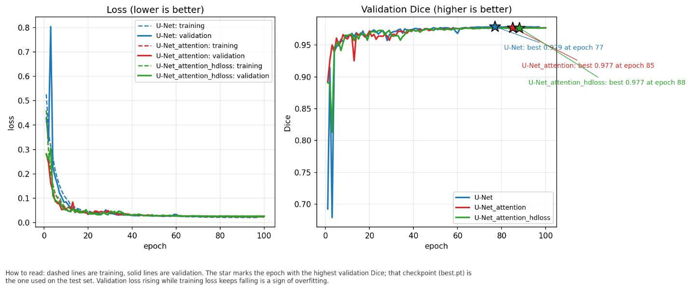</p>
<p align="center"><em>Training (dashed) and validation (solid) loss, and validation Dice per epoch for the three models. Stars mark the best validation Dice.</em></p>

Best validation Dice was 0.979 for the baseline (epoch 77), 0.977 for attention (epoch 85) and 0.977 for the HD variant (epoch 88). Validation loss flattens after about 40 epochs and stays close to training loss, so there is no strong sign of overfitting. The early validation dips occur in all three runs and recover within about 10 epochs.

### B7.2 Segmentation performance (test set, n = 56)

Each cell shows mean ± SD on the first line and median [IQR] on the second.

| Metric | Baseline U-Net | Attention U-Net | Attention + HD loss |
|---|---|---|---|
| Dice (up) | 0.969 ± 0.026<br>0.978 [0.968, 0.985] | 0.969 ± 0.023<br>0.976 [0.965, 0.983] | 0.969 ± 0.025<br>0.976 [0.963, 0.983] |
| IoU (up) | 0.941 ± 0.047<br>0.956 [0.939, 0.970] | 0.941 ± 0.041<br>0.954 [0.932, 0.967] | 0.940 ± 0.044<br>0.952 [0.928, 0.967] |
| Sensitivity (up) | 0.965 ± 0.042<br>0.976 [0.959, 0.990] | 0.969 ± 0.028<br>0.974 [0.961, 0.989] | 0.968 ± 0.030<br>0.974 [0.960, 0.989] |
| Specificity (up) | 0.992 ± 0.007<br>0.994 [0.989, 0.997] | 0.992 ± 0.007<br>0.993 [0.987, 0.997] | 0.992 ± 0.007<br>0.993 [0.988, 0.997] |
| Precision (up) | 0.974 ± 0.028<br>0.981 [0.971, 0.991] | 0.970 ± 0.038<br>0.983 [0.970, 0.989] | 0.971 ± 0.040<br>0.982 [0.969, 0.990] |
| ROC-AUC, pixel (up) | 0.999 ± 0.001<br>1.000 [0.999, 1.000] | 0.999 ± 0.001<br>1.000 [0.999, 1.000] | 0.999 ± 0.001<br>1.000 [0.999, 1.000] |
| PR-AUC, pixel (up) | 0.997 ± 0.008<br>0.999 [0.998, 1.000] | 0.997 ± 0.007<br>0.999 [0.997, 0.999] | 0.997 ± 0.006<br>0.999 [0.997, 1.000] |
| HD95, px (down) | 10.85 ± 6.34<br>9.64 [6.71, 12.04] | 11.67 ± 6.80<br>10.12 [7.62, 14.14] | 11.44 ± 6.78<br>10.53 [6.93, 14.12] |
| Avg. surface distance, px (down) | 4.67 ± 2.67<br>3.81 [3.06, 5.80] | 4.77 ± 2.24<br>4.29 [3.26, 5.99] | 4.78 ± 2.45<br>4.31 [3.03, 5.79] |
| Normalised surface distance (up) | 0.360 ± 0.194<br>0.340 [0.223, 0.490] | 0.336 ± 0.155<br>0.308 [0.214, 0.441] | 0.342 ± 0.177<br>0.287 [0.210, 0.456] |
| Absolute area error, px (down) | 286 ± 262<br>214 [86.5, 393] | 304 ± 212<br>253 [133, 418] | 298 ± 229<br>231 [122, 397] |
| Signed area error, px (pred − GT) | -40 ± 388<br>-53 [-211, 212] | -20 ± 372<br>-29 [-254, 246] | -30 ± 377<br>-44 [-234, 228] |
| Training loss (down) | 0.031 ± 0.020<br>0.024 [0.018, 0.034] | 0.029 ± 0.016<br>0.025 [0.018, 0.036] | 0.030 ± 0.018<br>0.025 [0.018, 0.035] |

All distances are in pixels (no pixel size supplied).

<p align="center">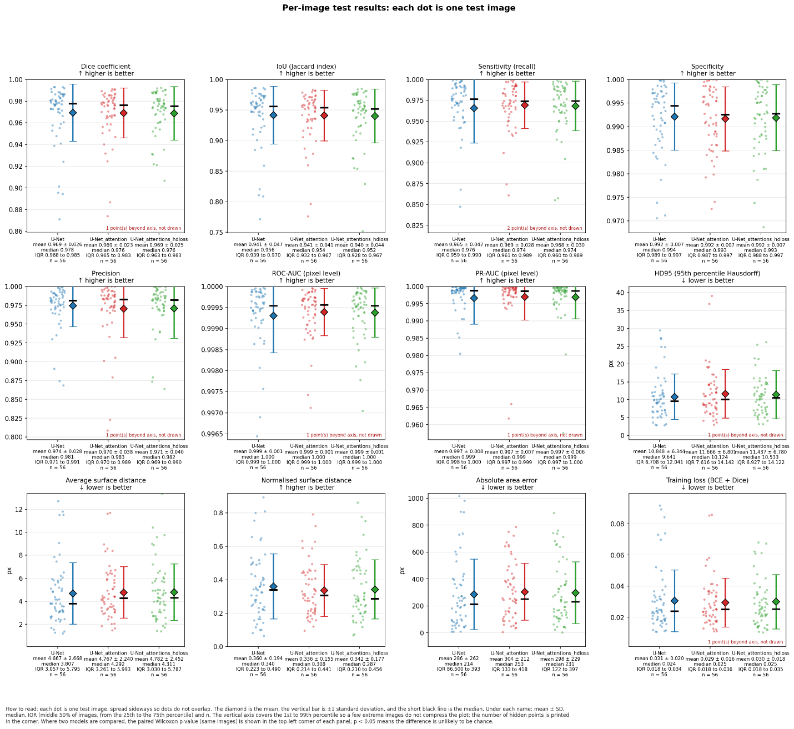</p>
<p align="center"><em>Per-image metrics for the three models. Each dot is one test image; the diamond is the mean and the black bar is the median. Click the image to zoom.</em></p>

<p align="center">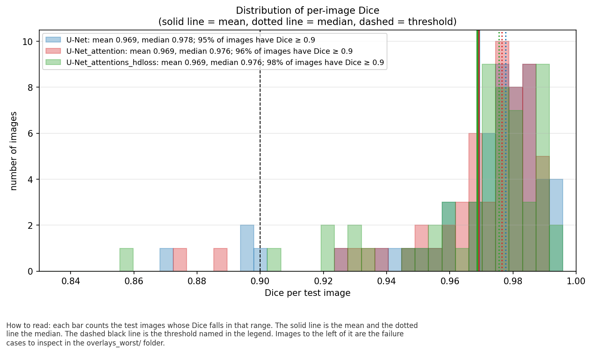</p>
<p align="center"><em>Histogram of per-image Dice. Images left of the dashed line (0.9) are failure cases to inspect.</em></p>

Dice is nearly identical across the three models (means 0.969). The share of images with Dice of at least 0.9 is 95 % (baseline), 96 % (attention) and 98 % (HD variant), so the baseline has 3 images below 0.9, attention 2 and the HD variant 1. The lowest per-image Dice is 0.871 (baseline), 0.874 (attention) and 0.858 (HD variant), all for the same image, `007_HC`.

<p align="center">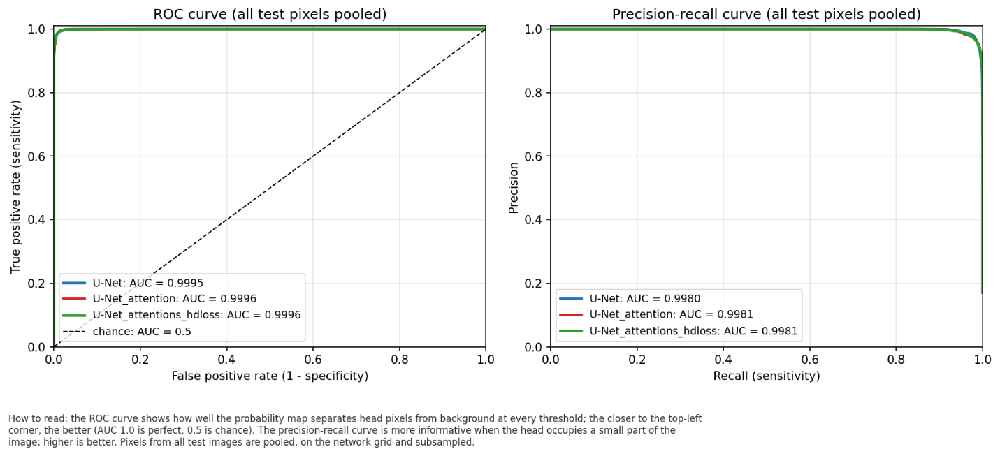</p>
<p align="center"><em>Pixel-level ROC and precision-recall curves for all three models, pooled over the test images.</em></p>

Pooled ROC-AUC is 0.9995 (baseline), 0.9996 (attention) and 0.9996 (HD variant); pooled PR-AUC is 0.9980, 0.9981 and 0.9981. The curves are almost indistinguishable at this scale, so the pixel-level ranking of head versus background is saturated for all three models.

### B7.3 Statistical comparison (paired tests, n = 56)

Paired Wilcoxon tests on the 56 test images. Only the baseline vs attention differences in Dice and HD95 are nominally significant (p = 0.013 each). After Holm correction across all 21 comparisons, neither survives (adjusted p = 0.26 and 0.27); all other adjusted values are 1.0.

| Metric | Baseline vs Attention (p) | Baseline vs HD variant (p) | Attention vs HD variant (p) |
|---|---|---|---|
| Dice | 0.013 (adj. 0.26) | 0.10 | 0.78 |
| Sensitivity | 0.30 | 0.22 | 0.45 |
| Specificity | 0.18 | 0.86 | 0.58 |
| Precision | 0.17 | 0.99 | 0.84 |
| HD95 | 0.013 (adj. 0.27) | 0.14 | 0.63 |
| Normalised surface distance | 0.081 | 0.13 | 0.73 |
| Area error (absolute) | 0.18 | 0.57 | 0.83 |

<p align="center">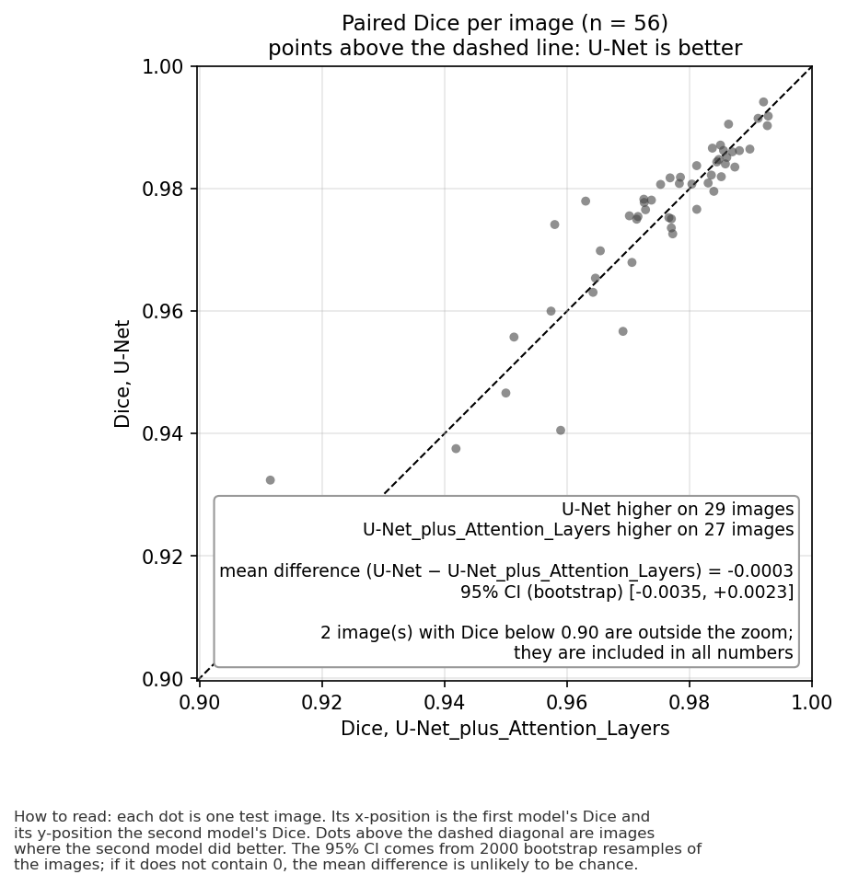</p>
<p align="center"><em>Per-image Dice for the baseline U-Net against the attention U-Net, paired by image. U-Net is higher on 29 images and attention on 27; the mean difference is -0.0003 (95 % bootstrap CI -0.0035 to +0.0023). Two images with Dice below 0.90 lie outside the zoom but are included in all numbers.</em></p>

### B7.4 Biometry (ellipse end-points and head circumference)

| Measure (px) | Baseline U-Net | Attention U-Net | Attention + HD loss |
|---|---|---|---|
| OFD end-point error | 17.6 ± 15.9<br>median 12.1<br>IQR 7.4 to 22.9<br>0 % within 2 px | 17.4 ± 13.8<br>median 11.8<br>IQR 7.2 to 26.7<br>0 % within 2 px | 18.6 ± 16.5<br>median 12.4<br>IQR 7.5 to 27.0<br>4 % within 2 px |
| BPD end-point error | 14.8 ± 13.7<br>median 9.5<br>IQR 5.7 to 19.1<br>4 % within 2 px | 14.4 ± 12.0<br>median 9.7<br>IQR 5.7 to 20.9<br>0 % within 2 px | 15.7 ± 14.3<br>median 10.4<br>IQR 5.7 to 22.6<br>4 % within 2 px |
| HC absolute error | 16.3 ± 17.7<br>median 9.9<br>IQR 3.7 to 21.0<br>11 % within 2 px | 18.4 ± 15.8<br>median 13.4<br>IQR 5.9 to 25.8<br>5 % within 2 px | 17.7 ± 16.6<br>median 11.6<br>IQR 7.0 to 22.5<br>5 % within 2 px |

End-point error is the mean of the two matched end-point distances per image (56 images). The "2 px" tolerance is the `--bio_tol_mm` setting of `tools/make_report_figures.py` (the figure labels it mm, but it is in pixels because no pixel size was used).

<p align="center">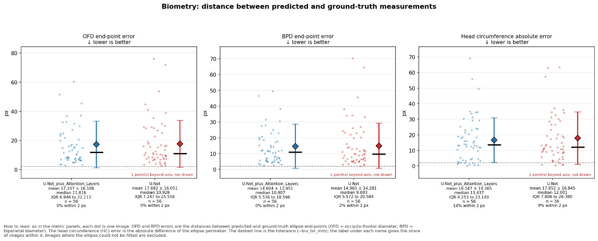</p>
<p align="center"><em>OFD end-point, BPD end-point and head-circumference absolute errors for the three models. Dashed line = 2 px tolerance.</em></p>

Biometry errors are similar across the three models. The HD variant has a slightly lower median HC error than attention (11.6 vs 13.4 px) but a slightly higher OFD and BPD median. Almost no image falls within the 2 px tolerance for OFD (0 to 4 %), so the tolerance is strict relative to the current error.

### B7.5 Critical analysis

**Overlap is near saturation, but the tail and the boundary matter.** Median Dice is 0.976 to 0.978, yet 1 to 3 images per model fall below 0.9 Dice, and HD95 exceeds 20 px in 4 to 6 images per model. The same image, `007_HC`, is the worst case for all three models, so the failures are shared rather than model-specific.

<p align="center"></p>
<p align="center"><em>Predicted mask, fitted ellipse and biometry points on the best (left) and worst (right) test images. Green = ground truth, red = prediction, yellow dots = OFD end-points, blue dots = BPD end-points. In the worst case (`007_HC`) the predicted contour departs visibly from the skull outline on one side.</em></p>

**Area bias is small, but the per-image spread is large.** The mean bias is -0.8 % (baseline), +0.1 % (attention) and 0.0 % (HD variant). The 95 % limits of agreement are about ±11 % of the ground-truth area for all three models. A Dice near 0.97 therefore hides a per-image area error of around 11 %.

<p align="center">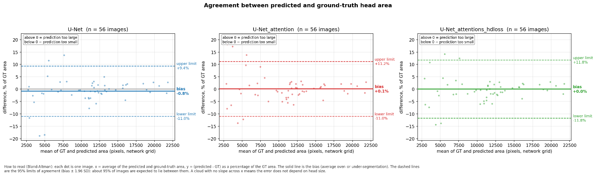</p>
<p align="center"><em>Predicted vs ground-truth area as a percentage of ground-truth area. Solid line = bias; dashed lines = 95 % limits of agreement.</em></p>

**Biometry error is larger than overlap suggests.** End-points lie at the extremes of the ellipse, where a small boundary error changes the axis length most. The median OFD end-point error is about 2.9 % of the median OFD (415 px) for all three models.

## B8. Key findings

- Skull segmentation is accurate: mean Dice 0.969 and pooled ROC-AUC 0.9995 or higher for all three models.
- Attention did not improve overlap or boundary accuracy, while adding 39 % parameters. Its median HD95 is slightly worse than the baseline.
- HD loss (weight 0.5) gave no consistent gain: HD95 was slightly lower than attention on the mean (11.4 vs 11.7 px) but not on the median, and biometry results were mixed.
- **Biometry is the bottleneck:** median OFD and BPD end-point errors of about 10 to 12 px, long tails, and almost no measurements within the 2 px tolerance.

**Final model selected: baseline U-Net.**

- *Accuracy is equal or better.* All three models reach the same mean Dice (0.969). The baseline has the highest median Dice (0.978) and the best validation Dice (0.979).
- *Biometry is no worse.* Median OFD and BPD errors are similar across models (about 10 to 12 px). The baseline has the lowest median HC error (9.9 px against 13.4 and 11.6) and the most HC measurements within 2 px (11 % against 5 % for both others).
- *It is simpler.* 7.76 M parameters against 10.79 M for attention, about 28 % fewer. Attention also adds roughly 35 to 40 % training time per step. The baseline is easier to train, explain and reproduce.
- *The extra components don't earn their cost.* Attention and the HD loss gave no significant gain after correction. Keeping them would add complexity and hyperparameters to defend without a measurable benefit.

## B9. Future work

The remaining planned experiments test whether each of my choices was necessary. Separating self-attention from cross-attention, and restricting attention to the deepest levels only, would show which mechanism does any work. Removing augmentation, comparing Dice-only and BCE-only losses, and changing the network width and input resolution would each test one assumption from Sections B3 to B5. I prefer one-factor-at-a-time changes, because if two things change together a difference cannot be attributed to either one.

---

# Comparing the two approaches

| | Part A: landmarks | Part B: segmentation + ellipse |
|---|---|---|
| What the network predicts | Four heatmaps, one per end-point | A filled skull mask |
| Where the end-points come from | Directly from the heatmap peaks | Geometrically, from a fitted ellipse's axes |
| What is easy to inspect | Per-landmark error, endpoint order, which landmark fails | Mask quality (Dice, HD95) separately from fitting error |
| Preprocessing of shape | Image stretched to a square (letterboxing planned) | Aspect ratio preserved by letterboxing |
| Data removed before training | 152 of 622 annotations (24.4 %) by a geometry rule | 2 of 622 outlines that could not be closed |
| Split | 376 / 47 / 47 images, patient-grouped | 506 / 58 / 56 images, patient-wise |
| What the overlap/accuracy metric hides | Mean error is nearly twice the median: a few images carry about 43 % of the error | Dice 0.97 hides about 11 % per-image area error and 10 to 12 px end-point error |

Two lessons carry across both parts. First, **a headline average hides the tail**: in both parts a few images dominate the error (Part A) or the same image fails for every model (Part B), so I report medians, spreads and failure shares next to means. Second, **the metric you optimise is not the clinical measurement**: Part A's better landmark placement did not mean better length agreement, and Part B's near-perfect Dice did not mean accurate end-points. Because the parts were evaluated on different test sets, units and splits, I do not claim that either approach is better overall.


# Repository guide

```
.
├── README.md                      # this write-up
├── part_a_landmark_detection/     # code for Part A
│   ├── scripts/                   #   train.py, evaluate.py, test.py
│   ├── src/                       #   model, dataset, augmentation, heatmap, losses, metrics, splitting, inference, report layer
│   ├── tools/                     #   check_dataset, prepare_data, predict, export_model, compare_models, visualize_heatmaps, check_model
│   ├── data/  weights/            #   not tracked
│   ├── run_pipeline.sh  requirements.txt  README.md
├── part_b_segmentation/           # code for Part B (same structure)
│   ├── scripts/                   #   train.py, evaluate.py (full evaluation), test.py
│   ├── src/                       #   U-Net, attention, losses (incl. HD loss), dataset, preprocessing, postprocess (ellipse fit), metrics
│   ├── tools/                     #   check_dataset, prepare_data, predict, export_model, quick_evaluate, make_report_figures, visualize_attention, check_model
│   ├── data/  weights/            #   not tracked
│   ├── run_pipeline.sh  requirements.txt  README.md
├── 
│   ├── images/                    # figures used in this README
│   └── reports/                   # the original PDF reports
├── requirements.txt               # installs both parts
└── LICENSE
```

Each part is run from inside its own folder; see [Part A](part_a_landmark_detection/README.md) and [Part B](part_b_segmentation/README.md) for the exact commands.

```bash
git clone https://github.com/<your-username>/fetal-head-biometry.git
cd fetal-head-biometry
python -m venv .venv && source .venv/bin/activate
pip install -r requirements.txt
cd part_a_landmark_detection   # or part_b_segmentation
bash run_pipeline.sh           # after copying the data into data/ (see data/README.md)
```

# References

- Ronneberger, O., Fischer, P., Brox, T. *U-Net: Convolutional Networks for Biomedical Image Segmentation.* MICCAI 2015.
- Zeng, Y., Tsui, P.-H., Wu, W., Zhou, Z., Wu, S. *Fetal Ultrasound Image Segmentation for Automatic Head Circumference Biometry Using Deeply Supervised Attention-Gated V-Net.* Journal of Digital Imaging 34:134 to 148, 2021.
- Karimi, D., Salcudean, S. E. *Reducing the Hausdorff Distance in Medical Image Segmentation with Convolutional Neural Networks.* IEEE Transactions on Medical Imaging, 2019.
- Payer, C., Štern, D., Bischof, H., Urschler, M. *Regressing Heatmaps for Multiple Landmark Localization using CNNs.* MICCAI 2016.
- Chen, R., Ma, Y., Chen, N., Lee, D., Wang, W. *Cephalometric Landmark Detection by Attentive Feature Pyramid Fusion and Regression-Voting.* MICCAI 2019.
- Noothout, J. M. H., de Vos, B. D., Wolterink, J. M., et al. *Deep Learning-Based Regression and Classification for Automatic Landmark Localization in Medical Images.* IEEE Transactions on Medical Imaging, 2020.
- Di Vece, C., Mao, Z., Avisdris, N., et al. *A multicentre benchmark dataset for comprehensive landmark-based fetal ultrasound biometry.* Scientific Reports. Dataset: https://github.com/surgical-vision/Multicentre-Fetal-Biometry
- ISUOG Clinical Standards Committee. *ISUOG Practice Guidelines (updated): performance of the routine mid-trimester fetal ultrasound scan.*

# Author

Athulya Krishnan
